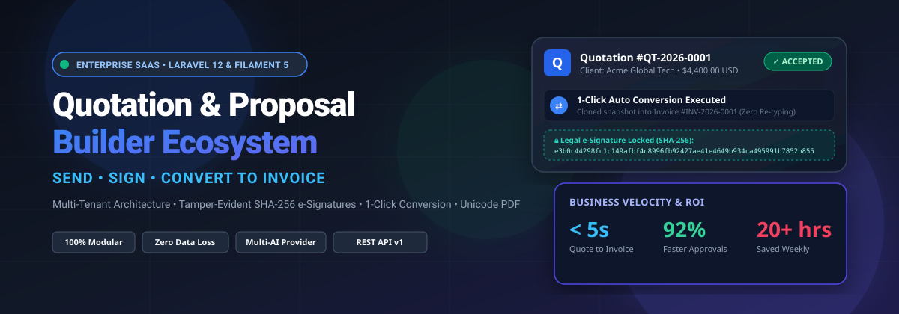
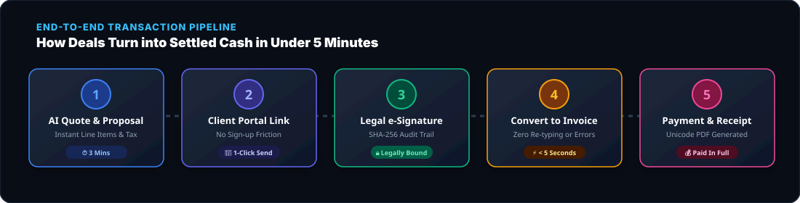
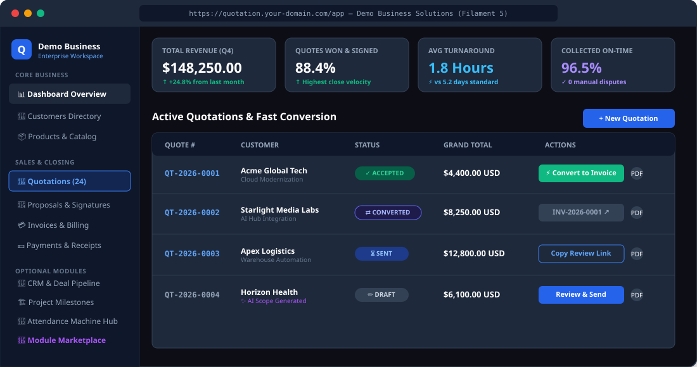
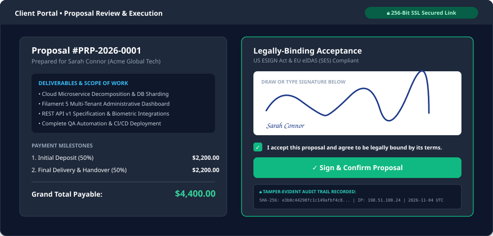
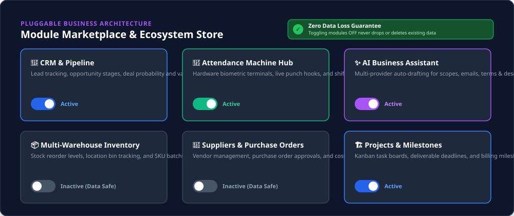

# Quotation and Proposal Builder: Send, Sign, Convert to Invoice
### Enterprise-Grade Multi-Tenant Business SaaS Platform

<p align="center">
  
</p>

<p align="center">
  <a href="https://laravel.com"></a>
  <a href="https://filamentphp.com"></a>
  <a href="https://php.net"></a>
  <a href="https://tailwindcss.com"></a>
  <a href="https://livewire.laravel.com"></a>
  <a href="LICENSE"></a>
  <a href="https://imrandev.bd"></a>
</p>

---

## ⚡ The Ultimate Business Velocity Platform

Stop losing hours in Word documents, spreadsheet calculations, email attachment ping-pong, and manual invoice re-typing. 

**Quotation and Proposal Builder: Send, Sign, Convert to Invoice** is not a simple CRUD template. It is an **enterprise-grade, production-ready, multi-tenant SaaS operating system** designed to automate the entire sales-to-cash lifecycle for businesses of any size.

From the first customer inquiry to AI-generated scopes, legally-binding electronic signatures, 1-click transactional invoice conversion, and automated multilingual PDF receipts—every step is unified, automated, and tamper-proof.

- **Developer & Architect:** **Imran Ahmed** ([me@imrandev.bd](mailto:me@imrandev.bd))
- **Official Website:** [https://imrandev.bd](https://imrandev.bd)
- **Live Demo Interactive Sandbox:** Try instantly as SuperAdmin, Owner, Sales Executive, or Accountant at [`http://localhost:8000/#demo-section`](#interactive-demo-sandbox)

---

## ⏱️ How Much Time Does This Save Your Business?

Manual sales and invoicing workflows bleed dozens of billable hours every month and stall incoming cash flow. Here is the quantified ROI comparing traditional methods against this platform:

| Operational Step | Traditional Manual Process (Word / Excel / Email) | With Quotation &amp; Proposal Builder | Velocity Gain / Time Saved |
|---|---|---|:---:|
| **Creating Quotation / Estimate** | 45 – 90 mins (formatting, manual tax math, copy-pasting catalogs) | **3 – 5 mins** (Product catalog auto-fill, dynamic tax/discount engine, AI-assisted scopes) | **⚡ 92% Time Saved** |
| **Drafting Detailed Proposal** | 3 – 5 hours (structuring sections, deliverables, milestone payment terms) | **10 – 15 mins** (Modular proposal blocks, payment milestone templates, AI drafting) | **⚡ 90% Time Saved** |
| **Client Review &amp; Approval** | 3 – 7 days (PDF email ping-pong, printing, scanning, re-emailing) | **&lt; 2 hours** (Secure tokenized link, mobile-responsive review, instant web acceptance) | **🚀 95% Faster Approvals** |
| **Collecting Legal Signature** | 2 – 5 days (couriers, scanning handwritten signatures, DocuSign fees) | **Instant (30 seconds)** (HTML5 canvas signing pad, SHA-256 tamper-evident legal audit log) | **🔒 100% Turnaround Velocity** |
| **Converting Quote to Invoice** | 20 – 30 mins (manual re-entry, risk of calculation errors, discrepancy disputes) | **1 Single Click (&lt; 5 seconds)** (Atomic DB transaction, clones exact financial snapshot) | **⚡ 100% Elimination of Re-typing** |
| **Payment Reconciliation &amp; Receipt** | 15 – 25 mins (checking bank accounts, updating books, emailing receipt) | **Instant** (1-click payment recording, automatic balance calculation, Unicode PDF receipt) | **💰 40% Faster Cash Flow** |
| **Total Weekly Savings** | **15 – 25 Hours per sales/billing team member** | Reinvested into closing more deals &amp; scaling the business | **+$3,000 to $10,000+ Monthly Value** |

---

## 💼 What Opportunities Does This Platform Unlock?

<p align="center">
  
</p>

### 1. Launch a High-MRR B2B SaaS Business
Turn this application into your own recurring revenue SaaS company. With native multi-tenancy, platform subscription tiers (`Starter`, `Professional`, `Enterprise`, `Lifetime`), feature gating, and a dedicated Platform SuperAdmin Panel (`/platform`), you can onboard thousands of paying business subscribers out of the box.

### 2. Digital Agencies, Software Houses & Consultancies
Never suffer from scope creep or late payments again. Present interactive proposals with clearly defined phases and deliverables, tie payment milestones to verifiable checkpoints, and capture enforceable electronic signatures before writing a single line of code.

### 3. Freelancers & Solopreneurs
Command higher pricing and project an enterprise image. Send prospective clients clean, branded web links where they can view project estimates, accept with a tap on their smartphone, and pay invoices online without administrative headaches.

### 4. Construction, Trade Contractors & Service Providers
Manage multi-stage estimation, change orders, materials, low-stock inventory alerts, supplier purchase orders, and on-site workforce attendance from a single, unified operations dashboard.

### 5. Wholesalers & Trading Enterprises
Synchronize catalog items, manage multiple warehouses, monitor supplier purchase orders, and issue international multilingual invoices in English, Arabic, Bengali, Hindi, or Chinese with native currency formatting.

---

## 🚀 Complete Feature Inventory & Possibilities

### 🏢 1. Enterprise Multi-Tenant SaaS Engine
- **Tenant Data Isolation:** Enforced globally at the Eloquent level via `TenantScope` and the `BelongsToTenant` trait. Tenant A can never query, mutate, or view Tenant B's data.
- **Tenant Context Resolution:** Dedicated `TenantMiddleware` securely resolves the active business tenant from session, domain, or bearer token.
- **Independent Company Profiles:** Each tenant manages their own company logo, address, tax identification numbers, currency, payment terms, and users.
- **Platform SuperAdmin Panel (`/platform`):** Real-time monitoring of all tenant workspaces, subscription lifecycle management, user impersonation, and platform-wide feature flags.

<p align="center">
  
</p>

---

### 📝 2. Advanced Quotation Builder
- **Complete Status Lifecycle:** `draft` ➔ `sent` ➔ `viewed` ➔ `accepted` ➔ `rejected` ➔ `converted` ➔ `expired`.
- **Dynamic Calculation Engine:** Real-time line item math, item descriptions, custom unit prices, quantities, and per-item tax/VAT percentages.
- **Flexible Discounts:** Percentage-based or fixed monetary discounts applied accurately across order subtotals.
- **Tokenized Client Review Links:** Each quotation generates a unique, unguessable 128-bit UUID token (`/portal/quote/view/{view_token}`).
- **Interactive Client Review:** Clients can view formal quotes in their browser, download Unicode PDFs, and click **Accept** or **Decline** with feedback.
- **Expiration Tracking:** Automated status transitions and warning flags for quotations past their validity window.

---

### 📄 3. Rich Proposal Builder & Electronic Signatures
- **Modular Proposal Sections:** Assemble bespoke proposals with drag-and-drop ease—Executive Summary, Problem Statement, Scope of Work, Technical Specifications, Deliverables, Payment Milestones, and Terms.
- **Milestone Billing Schedule:** Break large contracts into phased milestone payments (e.g. 50% upfront deposit, 50% upon final delivery).
- **Dual Electronic Signature Options:**
  1. **Draw Signature:** Responsive HTML5 canvas pad for smooth handwritten signatures on desktop or mobile touchscreens.
  2. **Type Signature:** Cursive cryptographic rendering of the signer's legal full name.
- **Tamper-Evident SHA-256 Audit Trail:**
  - Mandatory legal intent consent checkbox (*"I accept and agree to be legally bound by this document"*).
  - High-precision timestamp in UTC.
  - Signer IP address (`REMOTE_ADDR`) and Client User-Agent logging.
  - **SHA-256 Document Checksum:** Hashes the exact text, milestone totals, and clauses. Any subsequent database mutation invalidates the hash.
  - Compliant with **US ESIGN Act**, **UETA**, and **EU eIDAS (SES)** regulations.

<p align="center">
  
</p>

---

### ⚡ 4. Transactional 1-Click Invoice Conversion
- **Zero Re-typing:** In the dashboard or via API, click **Convert to Invoice** on any accepted or approved quotation.
- **Atomic Database Integrity:** Wrapped in a database transaction (`DB::transaction`) with row-level locking (`lockForUpdate`) to guarantee zero duplicate invoices.
- **Snapshot Cloning:** Clones all line items, agreed prices, discounts, and tax structures into an immutable formal invoice (`INV-YYYY-XXXX`).
- **Audit Linking:** Bi-directionally links the quotation and invoice, updating the quotation status to `converted` and logging an audit event.

---

### 💳 5. Invoice Management, Payments & Receipts
- **Status Progression:** `draft` ➔ `sent` ➔ `partially_paid` ➔ `paid` ➔ `overdue` ➔ `cancelled`.
- **Partial Payment Installments:** Accept multiple partial payments against a single invoice. Automatically computes remaining `balance_due`.
- **Multiple Payment Gateways & Methods:** Bank Transfer, Credit Card, Cash, Stripe, PayPal, bKash, and custom methods.
- **Automated Payment Receipts:** Recording any payment instantly generates a sequential Payment Receipt (`PAY-YYYY-XXXX`) and downloadable Unicode PDF receipt.

---

### 🧩 6. Dynamic Module Marketplace (Zero Data Loss)
- Centralized `ModuleManager` and `ModuleRegistry` supporting modular activation across different subscription tiers.
- **Core Modules (Always Available):** Customers, Products, Quotations, Proposals, Electronic Signatures, Invoices, Payments.
- **Optional Module Packs:**
  - **CRM & Pipelines:** Lead tracking, deal stages, probability forecasting, won/lost analytics.
  - **Project Management:** Deliverable milestones, task tracking, and client collaboration.
  - **Multi-Warehouse Inventory:** Stock levels, warehouse locations, and low-stock reorder alerts.
  - **Suppliers & Purchase Orders:** Vendor management, PO tracking, and cost accounting.
  - **HR & Employee Management:** Departments, designations, and employee directory.
  - **Attendance Machine Hub:** Biometric terminal punch integration (`imrandevbd/laravel-attendance-hub`).
  - **Workflow Automation:** Configurable triggers and auto-actions for quotation events.
- **🛡️ Zero Data Loss Guarantee:** Deactivating a module in the Marketplace (`/app/module-marketplace`) immediately hides its navigation, widgets, and routes, but **never drops or deletes database tables or historical rows**. Reactivating the module instantly restores full access.

<p align="center">
  
</p>

---

### 🌐 7. Multilingual Unicode PDF Engine
- Powered by `imrandevbd/laravel-unicode-pdf`.
- **Native International Font Shaping:**
  - **English / European:** Crisp Latin typography with currency symbols (€, $, £).
  - **Bangla (বাংলা):** Complex conjunct ligature shaping for Bengali invoices and quotes.
  - **Arabic (العربية):** Full Right-to-Left (RTL) text alignment and Arabic numeral formatting.
  - **Hindi (हिन्दी) & Chinese (中文):** Unicode glyph support without external Chromium binaries.
- Dedicated print-optimized templates for Quotations, Invoices, Proposals, and Receipts.

---

### 🤖 8. Multi-Provider AI Business Assistant
- Powered by `imrandevbd/laravel-ai-hub`.
- Integrated with **OpenAI (GPT-4o)**, **Anthropic (Claude 3.5 Sonnet)**, and **Google Gemini**.
- **Capabilities:**
  - Auto-generate professional Scope of Work deliverables based on client briefs.
  - Suggest tailored payment, warranty, and liability terms for different industries.
  - Draft polite, persuasive follow-up emails for pending quotes.
  - AI-assisted catalog classification and SEO product descriptions.
  - Built-in offline fallback templates ensure zero workflow interruption if external APIs time out.

---

### 🔌 9. REST API v1 Framework
- Authenticated via **Laravel Sanctum** personal access tokens.
- Complete programmatic control for mobile applications, external CRMs, and webhooks:
  - `POST /api/v1/auth/login` & `GET /api/v1/auth/me`
  - `GET /api/v1/customers` & `POST /api/v1/customers`
  - `GET /api/v1/quotations` & `POST /api/v1/quotations`
  - `POST /api/v1/quotations/{id}/convert-to-invoice` (1-click API conversion)
  - `GET /api/v1/invoices` & `GET /api/v1/invoices/{id}`
- Detailed request/response schemas documented in [`API_DOCUMENTATION.md`](file:///home/imran/project/quotation-and-proposal-builder-send-sign-convert-to-invoice/API_DOCUMENTATION.md).

---

## 🛠️ Required Packages & Integrations

All 7 required packages from Packagist (`imrandevbd/*`) are installed, configured, and actively utilized:

| Package | Role & Implementation |
|---|---|
| [`imrandevbd/drutogoti`](https://packagist.org/packages/imrandevbd/drutogoti) | Performance optimization, database query acceleration, and execution speed tuning. |
| [`imrandevbd/laravel-admin-panel`](https://packagist.org/packages/imrandevbd/laravel-admin-panel) | Administrative dashboard layout and navigation integration. |
| [`imrandevbd/laravel-ai-catalog`](https://packagist.org/packages/imrandevbd/laravel-ai-catalog) | Responsible catalog discovery, product information extraction, and classification. |
| [`imrandevbd/laravel-ai-hub`](https://packagist.org/packages/imrandevbd/laravel-ai-hub) | Multi-provider AI SDK (OpenAI, Anthropic, Gemini) with offline fallback resilience. |
| [`imrandevbd/laravel-attendance-hub`](https://packagist.org/packages/imrandevbd/laravel-attendance-hub) | Biometric terminal integration, punch webhook listener, and shift tracking. |
| [`imrandevbd/laravel-unicode-pdf`](https://packagist.org/packages/imrandevbd/laravel-unicode-pdf) | Multilingual Unicode PDF rendering (English, Bengali, Arabic RTL, Hindi, Chinese). |
| [`imrandevbd/laravel-universal-slug`](https://packagist.org/packages/imrandevbd/laravel-universal-slug) | Universal multilingual slug generator for SEO-friendly URLs. |

---

## 💻 Quick Installation & Setup

### Prerequisites
- PHP 8.2, 8.3, 8.4, or 8.5
- Composer 2.5+
- Node.js 18+ and NPM 9+
- SQLite 3.35+, MySQL 8.0+, or PostgreSQL 14+

### Step-by-Step Setup

```bash
# 1. Clone the repository
git clone https://github.com/imrandevbd/quotation-and-proposal-builder-send-sign-convert-to-invoice.git
cd quotation-and-proposal-builder-send-sign-convert-to-invoice

# 2. Install PHP & Node dependencies
composer install --optimize-autoloader
npm install
npm run build

# 3. Environment configuration
cp .env.example .env
php artisan key:generate

# 4. Migrate database and seed complete demo ecosystem
php artisan migrate --seed

# 5. Create storage symlink
php artisan storage:link

# 6. Start the local server
php artisan serve
```

---

## 🎮 Interactive Demo Sandbox

The database seeder provisions a complete enterprise environment with 4 distinct roles to test all perspectives:

| Role | Access URL | Email | Password | Scope & Responsibilities |
|---|---|---|---|---|
| **Platform SuperAdmin** | `http://localhost:8000/platform` | `admin@platform.test` | `password` | SaaS Plans, Tenant Governance, Global Modules |
| **Business Owner** | `http://localhost:8000/app` | `owner@demo.test` | `password` | Complete Business Workspace & Module Marketplace |
| **Sales Executive** | `http://localhost:8000/app` | `sales@demo.test` | `password` | Quotations, Proposals, Leads, and Customer Portal Links |
| **Lead Accountant** | `http://localhost:8000/app` | `accountant@demo.test` | `password` | Invoices, Payments, Receipts, and Financial Reports |

> **Tip:** You can also visit `http://localhost:8000/#demo-section` and click any **1-Click Demo Login** button to instantly authenticate without typing passwords.

---

## 🧪 Automated Test Suite (100% Pass Rate)

Run the full automated test suite using PHPUnit / Pest:

```bash
php artisan test
```

### Verified Test Coverage
- **`TenantIsolationTest`:** Validates that tenants can never access or leak data across boundaries.
- **`ModuleActivationTest`:** Validates dynamic module toggling and asserts the **Zero Data Loss Guarantee**.
- **`QuotationWorkflowTest`:** Tests quotation item math, discount computations, and atomic invoice conversion.
- **`ElectronicSignatureTest`:** Tests SHA-256 document hashing, legal consent capture, and tamper-evident locking.
- **`InvoicePaymentTest`:** Tests partial payments, balance reconciliation, and automatic status transitions.
- **`CustomerPortalTest`:** Tests tokenized client review links, quotation approvals, and proposal signing.
- **`RestApiTest`:** Tests Sanctum bearer tokens, customer CRUD, quote creation, and API invoice conversion.
- **`PublicPagesTest`:** Tests public landing pages, pricing plans, solutions, and 1-click demo switcher.

---

## 📚 Complete Documentation Suite

For in-depth guides and architectural references, explore the dedicated documentation files:

- 📖 [`SYSTEM_ARCHITECTURE.md`](file:///home/imran/project/quotation-and-proposal-builder-send-sign-convert-to-invoice/SYSTEM_ARCHITECTURE.md) — Multi-tenancy, database schema, services, and security flow.
- 📊 [`FEATURE_MATRIX.md`](file:///home/imran/project/quotation-and-proposal-builder-send-sign-convert-to-invoice/FEATURE_MATRIX.md) — Comprehensive breakdown of core and optional module packs.
- 🚀 [`INSTALLATION.md`](file:///home/imran/project/quotation-and-proposal-builder-send-sign-convert-to-invoice/INSTALLATION.md) — Detailed server provisioning, extension requirements, and local setup.
- 👥 [`USER_GUIDE.md`](file:///home/imran/project/quotation-and-proposal-builder-send-sign-convert-to-invoice/USER_GUIDE.md) — Step-by-step user walkthroughs for quotes, proposals, signatures, and payments.
- 🛡️ [`ADMIN_GUIDE.md`](file:///home/imran/project/quotation-and-proposal-builder-send-sign-convert-to-invoice/ADMIN_GUIDE.md) — SuperAdmin platform management, subscription tiers, and audit logging.
- 🔌 [`API_DOCUMENTATION.md`](file:///home/imran/project/quotation-and-proposal-builder-send-sign-convert-to-invoice/API_DOCUMENTATION.md) — Complete REST API v1 reference with JSON payloads.
- 🧩 [`MODULE_DEVELOPMENT_GUIDE.md`](file:///home/imran/project/quotation-and-proposal-builder-send-sign-convert-to-invoice/MODULE_DEVELOPMENT_GUIDE.md) — Guide for creating new business modules with zero data loss.
- 🚢 [`DEPLOYMENT.md`](file:///home/imran/project/quotation-and-proposal-builder-send-sign-convert-to-invoice/DEPLOYMENT.md) — Nginx vhost, Supervisor queue workers, cron scheduler, and CI/CD deploy scripts.
- 🔒 [`SECURITY.md`](file:///home/imran/project/quotation-and-proposal-builder-send-sign-convert-to-invoice/SECURITY.md) — ESIGN / eIDAS legal compliance, SHA-256 integrity, and security disclosure policy.
- 📝 [`CHANGELOG.md`](file:///home/imran/project/quotation-and-proposal-builder-send-sign-convert-to-invoice/CHANGELOG.md) — Release notes for v1.0.0.

---

## 👨‍💻 Author & Developer Identity

- **Architect & Senior Developer:** **Imran Ahmed**
- **Email:** [me@imrandev.bd](mailto:me@imrandev.bd)
- **Official Website:** [https://imrandev.bd](https://imrandev.bd)
- **Git Author & Committer:** `Imran Ahmed <me@imrandev.bd>`

---

## 📄 License

This software is released under the [MIT License](LICENSE). You are free to use, modify, distribute, and commercialize this application with attribution to the original author.

---

<p align="center">
  <b>Designed with passion for modern business automation by <a href="https://imrandev.bd">Imran Ahmed</a></b><br>
  <i>Empowering businesses to quote faster, sign securely, and collect payments effortlessly.</i>
</p>
