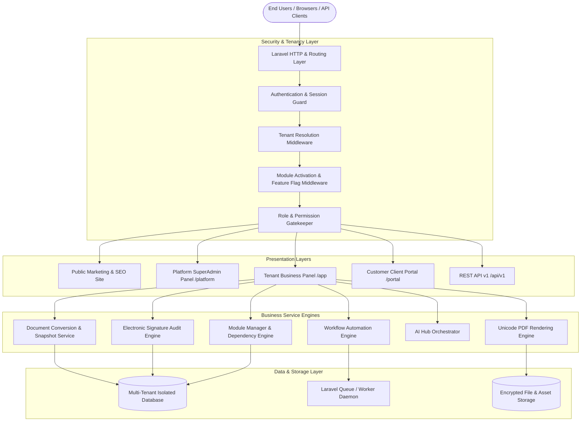
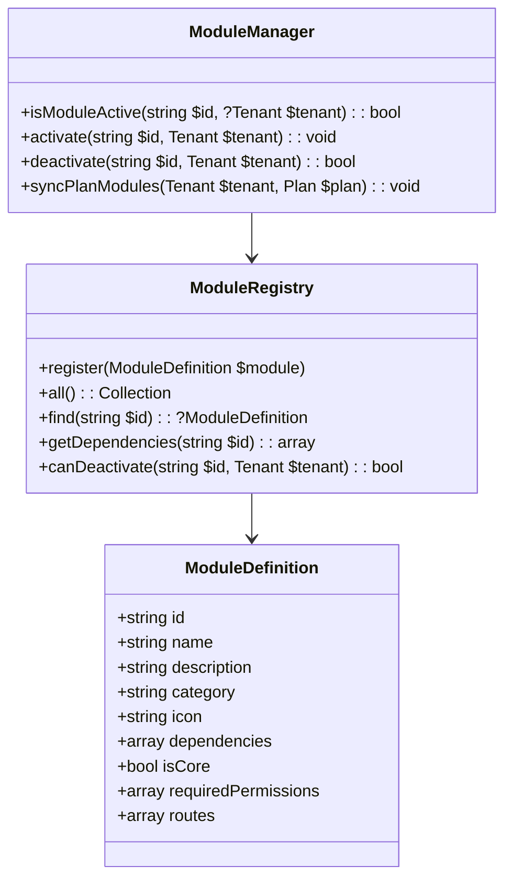
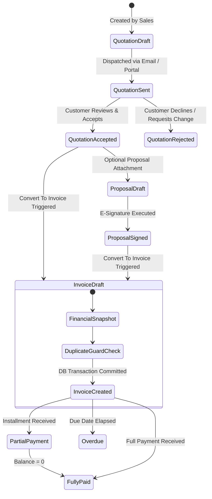

# SYSTEM ARCHITECTURE

**System Name:** Quotation and Proposal Builder: Send, Sign, Convert to Invoice  
**Architect & Developer:** Imran Ahmed (<me@imrandev.bd>) | [https://imrandev.bd](https://imrandev.bd)  
**Framework Stack:** Laravel 12.x | Filament 5.x | Livewire 4.x | Tailwind CSS | SQLite / MySQL / PostgreSQL  

---

## 1. Architectural Overview

The application follows an **Enterprise Modular Multi-Tenant Domain Architecture**. It bridges the flexibility of a customizable ERP/CRM suite with the focus of a specialized quotation, proposal, signature, and invoice generation engine.

---

## 2. Multi-Tenancy Isolation Strategy

The platform utilizes a **Shared Database with Strict Tenant Scoping** (`tenant_id` isolation), verified by automated integration tests and policy assertions.

### Core Tenancy Principles:
1. **Tenant Context Resolution:**
   - Evaluated via authenticated user tenancy, tenant session bindings, or subdomain/slug tokens.
   - Initialized into a singleton `TenantContext` service during HTTP request lifecycle.
2. **Global Eloquent Scoping (`TenantScope`):**
   - Applied across every tenant-owned model (`Customer`, `Product`, `Quotation`, `Proposal`, `Invoice`, `Payment`, `Project`, etc.).
   - Automatically injects `WHERE tenant_id = ?` into queries and auto-sets `tenant_id` upon model creation.
3. **Tenant-Aware Policies:**
   - Server-side authorization confirms that resources being viewed, modified, or converted strictly match `auth()->user()->tenant_id`.
4. **Public Link Security:**
   - Customer document views (e.g. reviewing quotes or signing proposals) use cryptographic UUID tokens (`view_token` / `sign_token`) with optional expiry and revocation rules. Direct enumeration or sequential IDs are blocked.

---

## 3. Central Module Registry & Feature Flag Engine

Unlike traditional monoliths with scattered hardcoded checks, all modules are registered in a centralized `ModuleRegistry`.

### Module Deactivation Guarantees:
- **Zero Historical Data Deletion:** Deactivating a module (e.g., `inventory` or `attendance`) disables routes, hides Filament navigation items, suppresses dashboard widgets, and prevents new record mutations. **Existing database tables and historical rows are never dropped or deleted.**
- **Dependency Guard:** If Module A (e.g. `invoices`) critically requires Module B (e.g. `customers`), the Module Manager blocks disabling Module B until dependent modules are addressed.
- **Tenant Independence:** Tenant A can operate as a lean quotation-only service, while Tenant B runs full enterprise operations (Projects, Expenses, Inventory, Attendance).

---

## 4. Financial Document Conversion & State Machine

The Quotation-to-Invoice workflow adheres to strict transactional boundaries:

### Financial Snapshot & Idempotency Rules:
- A database transaction wraps the creation of the invoice and its line items.
- Line items are copied as historical snapshots (description, unit price, quantity, discount percentage/amount, tax percentage/amount). If product catalog prices change later, historical quotation/invoice calculations remain 100% intact.
- An idempotency lock (`converted_invoice_id`) on the quotation guarantees that rapid double-clicks or repeated API calls cannot spawn duplicate invoices.

---

## 5. Electronic Signature Audit Engine

1. **Signer Onboarding:**
   - Signer receives a tokenized URL (`/portal/sign/{sign_token}`).
   - Document metadata and current terms are rendered in a tamper-evident view.
2. **Consent & Verification:**
   - Signer provides full legal name, email, confirms legal intent checkbox, and submits typed/drawn signature.
3. **Immutable Audit Record:**
   - A row is inserted into `document_signatures` with:
     - `tenant_id`, `document_type`, `document_id`
     - `signer_name`, `signer_email`
     - `signature_data` (Base64 SVG or typed font representation)
     - `ip_address` (resolved via trusted proxy headers)
     - `user_agent`
     - `checksum_sha256` (computed over document content at signature time)
     - `signed_at` timestamp
4. **Document Locking:**
   - Document state locks to `signed`. Infolists and forms disable edit fields for that version.

---

## 6. Multilingual Unicode PDF Engine

Powered by `imrandevbd/laravel-unicode-pdf`:
- Supports standard LTR scripts (English, French, German, Spanish).
- Full Unicode complex text shaping for Indic/Bangla scripts (`Noto Sans Bengali`).
- Full RTL bidirectional text layout for Arabic/Persian/Urdu (`Noto Sans Arabic`).
- Currency symbol safety: standard decimal formatting, locale-based thousand separators, and ISO currency code preservation.

---

## 7. AI Business Assistant Engine

Powered by `imrandevbd/laravel-ai-hub`:
- Multi-provider abstraction: OpenAI, Anthropic Claude, Google Gemini, DeepSeek, Groq, Mistral, Ollama.
- Tenant-level quota checks: Tenants cannot exceed their plan's monthly AI token/call limits.
- Safety & Fallback: AI produces editable drafts requiring human review before dispatch. If AI service times out, core manual document editing remains fully operational.
